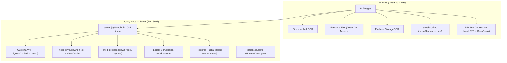
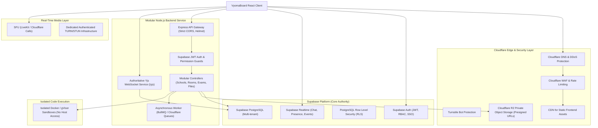

# VYOMABOARD — PRODUCTION ARCHITECTURE SPECIFICATION

## 1. System Overview
VyomaBoard is a cloud-based, multi-tenant collaborative educational whiteboard, classroom management, and examination platform. It enables educators and educational institutions to conduct live classes with real-time vector canvas manipulation, persistent document annotations, rich media sharing (PDF, PPT, Word, Excel), real-time audio/video/screen broadcasting, proctored coding assessments, and student performance analytics.

---

## 2. Current Architecture vs. Target Production Architecture

### 2.1 Current Architecture (Legacy & Vulnerable)

### Critical Flaws in Current Architecture:
1. **Direct Untrusted Client-to-Database Coupling**: The frontend directly manipulates Firestore without server-side validation or Row Level Security (RLS).
2. **Competing & Split Data Stores**: Users are stored simultaneously in SQLite (`seed-accounts.js`), PostgreSQL (`server.js`), and Firestore (`Auth.jsx`).
3. **Public Unencrypted Demonstration Synchronization**: Collaborative whiteboard updates flow through `demos.yjs.dev/ws`, exposing student and school canvas data to the public internet.
4. **Host Command & Shell Execution**: Students can run arbitrary system commands via `/api/terminal` (raw `cmd.exe`/`bash` PTY) and `/api/run-code` (regex-bypassed host subprocesses).
5. **Full Mesh WebRTC with Hardcoded Public Credentials**: Every student connects to every other student ($O(N^2)$ connections) with public metered credentials (`openrelayproject`).
6. **In-Memory Volatile Communication**: Live chat messages and direct messages are lost upon server restart (`const commsRooms = {}; const chatHistory = {};`).
7. **Broken Backup Cron**: Attempts to copy an undefined variable `dbPath` to SQLite backup files nightly.

---

### 2.2 Target Production Architecture

---

## 3. Technology Stack Allocation & Responsibilities

| Responsibility | Service / Technology | Justification |
| :--- | :--- | :--- |
| **Edge Security & Routing** | Cloudflare (WAF, DNS, Turnstile, CDN) | World-class DDoS mitigation, sub-millisecond edge TLS termination, bot filtering. |
| **Object Storage** | Cloudflare R2 | Zero egress fees, private buckets, short-lived HMAC signed upload/download URLs. |
| **Primary Identity & Auth** | Supabase Auth | Native support for email/password, Google OAuth, SAML SSO, and secure JWTs. |
| **Relational Multi-tenant DB**| Supabase PostgreSQL | Strong ACID guarantees, native JSONB, connection pooling (PgBouncer), Point-In-Time Recovery. |
| **Authorization & Tenant Isolation** | PostgreSQL Row Level Security (RLS) | Database-level policy enforcement preventing tenant data leaks regardless of application layer bugs. |
| **Realtime Chat & Notifications** | Supabase Realtime | Native PostgreSQL replication stream for instant group chat, direct messages, and roster events. |
| **Collaborative Canvas Engine** | Yjs + Authoritative Server (/yjs) | Conflict-free replicated data types (CRDTs), debounced snapshot persistence into PostgreSQL. |
| **Voice, Video & Screen Share** | LiveKit / Cloudflare Calls SFU | Selective Forwarding Unit eliminating client bandwidth bottlenecks ($O(N)$ vs $O(N^2)$ mesh). |
| **Business Logic & API** | Node.js (Express Modular Architecture) | Type-safe validation (Zod), structured error handling, tokenized media provisioning. |
| **Isolated Code Execution** | Dedicated Worker Containers / Wandbox | Zero host execution risk, memory/CPU quotas, non-root disposable runtime. |

---

## 4. Key Security Boundaries
1. **Zero-Trust Client Access**: No frontend client may write directly to any table without a valid authenticated session evaluated by PostgreSQL RLS.
2. **Private File Enclave**: No uploaded document or exam attachment is publicly downloadable via static endpoints. All downloads require server-signed URLs valid for $\le 15$ minutes.
3. **No Host Access for Execution**: Student programming assignments and terminal sessions execute in sandboxed, network-restricted containers with zero access to filesystem roots, database credentials, or host sockets.
4. **Tenant Isolation**: Every database entity includes a `school_id` foreign key. RLS enforces that a member of School A cannot view, query, or mutate resources belonging to School B.
