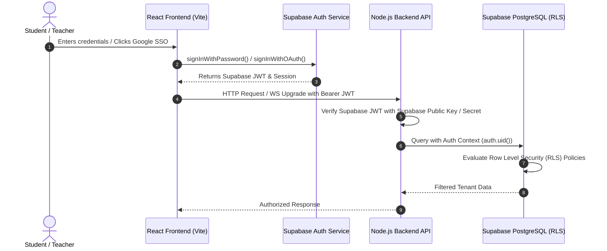

# VYOMABOARD — AUTHENTICATION & ROLE-BASED ACCESS CONTROL (SUPABASE AUTH)

## 1. Migration from Firebase to Supabase Auth
The existing application currently relies on a confusing dual authentication system:
* Firebase Auth handles Google and Email/Password sign-ins on the frontend (`Auth.jsx`).
* A custom JWT token signed with an insecure secret is issued on the backend (`server.js`).
* The frontend passes Firebase ID tokens to WebSocket connections expecting custom JWTs, forcing an insecure hardcoded fallback `dev-mode-token-12345`.

### Target Architecture: Supabase Auth as the Single Source of Truth

---

## 2. Preserved Authentication Workflows

### 2.1 Standard Email & Password
* Client calls `supabase.auth.signInWithPassword({ email, password })`.
* Backend verifies the token using the Supabase JWT secret or JWKS endpoint.

### 2.2 Google Workspace & OAuth
* Client calls `supabase.auth.signInWithOAuth({ provider: 'google', options: { hd: schoolDomain } })`.
* Restricts sign-in to the specific Google Workspace domain configured for the school.

### 2.3 School Enterprise SSO (SAML 2.0 / OIDC)
* Configured via Supabase Enterprise SSO.
* The school provides its IdP metadata URL or certificate; Supabase automatically directs users through SAML flow.

### 2.4 No-Account School Login (Name + PRN / Roll Number)
* Used by institutions that do not issue individual email addresses to students.
* Student enters Name, PRN (Permanent Registration Number), Year, and Division.
* Backend issues an ephemeral scoped session restricted strictly to the designated classroom and examination room.

---

## 3. Role Hierarchy & Granular Permissions

| System Role | Scope | Permissions |
| :--- | :--- | :--- |
| **`super_admin`** | Platform-wide | Manage schools, platform-level audit logs, infrastructure settings. |
| **`school_admin`**| School Tenant | Add/remove teachers, configure school auth, manage classrooms, view school gradebooks. |
| **`teacher`** | School / Assigned Classrooms | Create whiteboards, launch exams, grade submissions, kick disruptive participants, start calls. |
| **`ta`** (Assistant) | Assigned Classrooms | View classroom submissions, assist in grading, monitor live whiteboard. |
| **`student`** | Enrolled Classrooms | Join classes, collaborate on boards, submit exams, view personal grades. |
| **`guest`** | Specific Room | Read-only or temporary canvas participant; cannot access exam questions or chat history. |

---

## 4. Token Lifecycle & Expiration Protocol
1. **Access Token Lifespan**: 1 hour (3600 seconds).
2. **Refresh Tokens**: Stored in secure, HTTP-only, SameSite cookies or managed securely by `@supabase/supabase-js`.
3. **No `ignoreExpiration`**: All backend middleware enforces token expiration strictly. If expired, client must refresh session before making API or WebSocket requests.
