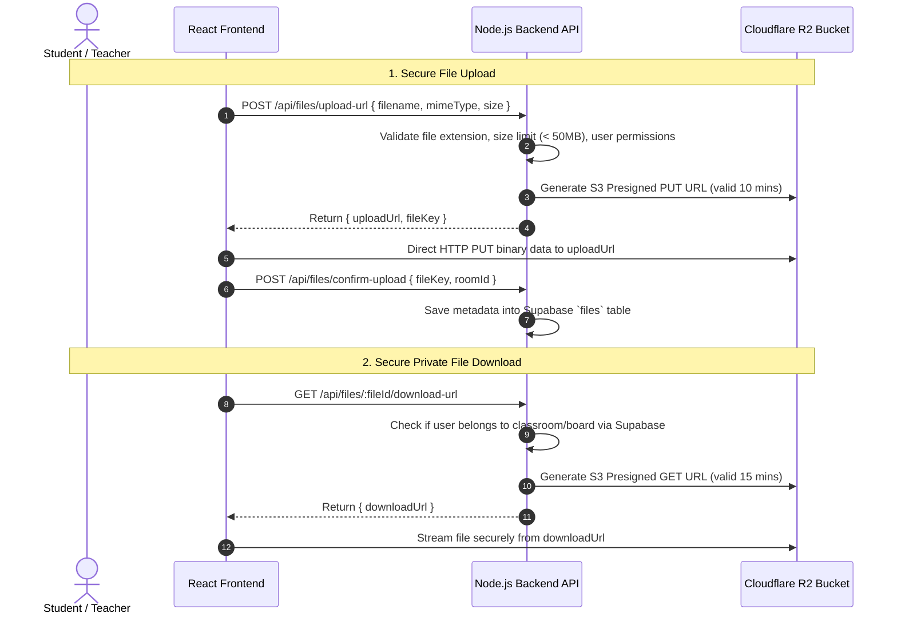

# VYOMABOARD — CLOUDFLARE EDGE & R2 INFRASTRUCTURE SETUP

## 1. Cloudflare Products & Responsibilities
VyomaBoard leverages Cloudflare as an enterprise edge protection, content delivery, and private object storage backbone.

---

## 2. Cloudflare Configuration Details

### 2.1 Cloudflare DNS, CDN & WAF
1. **DNS**: Point your application domains to Cloudflare nameservers with `Proxied (Orange Cloud)` enabled:
   * `app.vyomaboard.com` (Frontend React SPA)
   * `api.vyomaboard.com` (Node.js API & WebSocket Gateway)
2. **Web Application Firewall (WAF)**:
   * Block malicious bot traffic, known exploit patterns, and SQLi / XSS injection vectors at the edge.
   * Enforce aggressive rate limiting on `/api/auth/*` (max 10 requests / minute per IP).
3. **Turnstile Bot Protection**:
   * Integrated into the registration and login forms to eliminate automated brute-force attacks and credential stuffing without intrusive CAPTCHAs.

---

### 2.2 Cloudflare R2 Private Object Storage
Replaces vulnerable local disk file storage (`backend/uploads/`) with high-durability private S3-compatible cloud storage.

#### Bucket Configuration:
* **Bucket Name**: `vyomaboard-assets`
* **Access Mode**: **100% Private** (Public bucket URL access is disabled).
* **CORS Policy**:
  ```json
  [
    {
      "AllowedOrigins": ["https://app.vyomaboard.com", "http://localhost:5173"],
      "AllowedMethods": ["GET", "PUT", "POST", "DELETE", "HEAD"],
      "AllowedHeaders": ["*"],
      "ExposeHeaders": ["ETag"],
      "MaxAgeSeconds": 3600
    }
  ]
  ```

#### Presigned URL Protocol for Secure File Access:


---

### 2.3 Cloudflare Queues & Background Processing
Used for asynchronous, resource-intensive operations to avoid blocking the main Node.js event loop:
1. **PPT / PPTX to PDF Conversion**: Asynchronous conversion queue.
2. **Student Submission Archive Export**: Generating ZIP archives of all exam submissions for teachers.
3. **Email Notifications**: Welcome emails, exam grade announcements, password reset dispatches.
