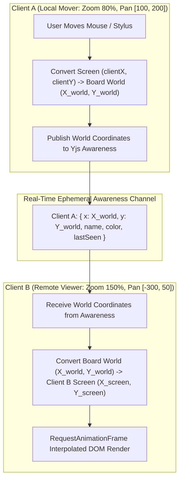

# VYOMABOARD — LIVE CURSOR SYSTEM ARCHITECTURE SPECIFICATION

## 1. Root Cause Analysis of Existing Cursor Failures

### 1.1 The Dual-Writer Awareness Conflict
In the legacy codebase, two separate modules wrote conflicting coordinate systems to the same Yjs awareness field `pointer`:
1. **`ExcalidrawCanvas.jsx:430`**:
   `awareness.setLocalStateField('pointer', payload.pointer);`
   Here, `payload.pointer` represents **Excalidraw Scene / Board coordinates** $(X_{\text{scene}}, Y_{\text{scene}})$.
2. **`CustomCursorOverlay.jsx:87`**:
   `window.addEventListener('mousemove', (e) => { awareness.setLocalStateField('pointer', { x: e.clientX, y: e.clientY }); });`
   Here, `e.clientX` represents **Browser Viewport / Screen coordinates** $(X_{\text{screen}}, Y_{\text{screen}})$.

**The Glitch**: As the user moved the mouse, `CustomCursorOverlay` and `ExcalidrawCanvas` alternated writing screen coordinates and scene coordinates into the awareness state multiple times per millisecond.

### 1.2 The Double-Transformation Bug
In `CustomCursorOverlay.jsx:65-66`:
```javascript
x = (cursor.x + scrollX) * zoom;
y = (cursor.y + scrollY) * zoom;
```
* If `cursor.x` came from Excalidraw, it was *already* in scene coordinates. Adding `scrollX` and multiplying by `zoom` transformed the coordinates **twice**, sending cursors hundreds of pixels into void space whenever zoom $\ne 100\%$ or scroll $\ne 0$.
* If `cursor.x` came from `clientX`, it treated Client A's viewport pixel position as if it were a board position, disregarding Client A's zoom, window dimensions, and scroll position entirely.

### 1.3 Memory Leaks & Ghost Cursors
* Awareness states did not unregister cleanly on window blur, tab switch, or disconnect.
* Stale cursors persisted on screen because cleanup relied on an arbitrary 15-second timeout rather than reactive Yjs awareness lifecycle hooks (`awareness.on('change')` with client removal detection).

---

## 2. Target Architecture: Figma-Style World Coordinate Engine



### 2.1 The Canonical Mathematical Transformation
All cursor positions transmitted over the network must exist in **Board World Space** $(X_{\text{world}}, Y_{\text{world}})$.

#### 1. Local Screen to Board World (Sender):
Given viewport coordinate $(X_{\text{client}}, Y_{\text{client}})$, container offset $(O_x, O_y)$, board pan / scroll $(S_x, S_y)$, and zoom factor $Z$:
$$X_{\text{world}} = \frac{X_{\text{client}} - O_x}{Z} - S_x$$
$$Y_{\text{world}} = \frac{Y_{\text{client}} - O_y}{Z} - S_y$$

#### 2. Board World to Remote Screen (Receiver):
When Client B renders Client A's cursor at $(X_{\text{world}}, Y_{\text{world}})$, using Client B's local container offset $(O'_x, O'_y)$, local pan $(S'_x, S'_y)$, and local zoom $Z'$:
$$X'_{\text{screen}} = (X_{\text{world}} + S'_x) \times Z' + O'_x$$
$$Y'_{\text{screen}} = (Y_{\text{world}} + S'_y) \times Z' + O'_y$$

**Mathematical Proof of Alignment**: Regardless of viewport size, device DPI, monitor aspect ratio, or independent zoom levels, both participants resolve to the exact same visual point on the canvas without coordinate drift.

---

## 3. High-Performance RAF Rendering Pipeline
1. **Throttled Awareness Broadcast**: Cursor updates are throttled to 30–50 updates/sec using an internal timer or RAF accumulator, preventing WebSocket channel saturation.
2. **Decoupled DOM Rendering**: Awareness updates update a reactive `Map` ref. A single `requestAnimationFrame` loop reads the ref and updates CSS transforms (`translate3d(x, y, 0)`) without triggering React reconciliation on every mouse move.
3. **Instant Disconnect Garbage Collection**:
   * When an awareness `change` event fires, removed client IDs are purged immediately from the active render map.
   * Cursors inactive for $> 5000\text{ ms}$ are automatically faded out and removed.
