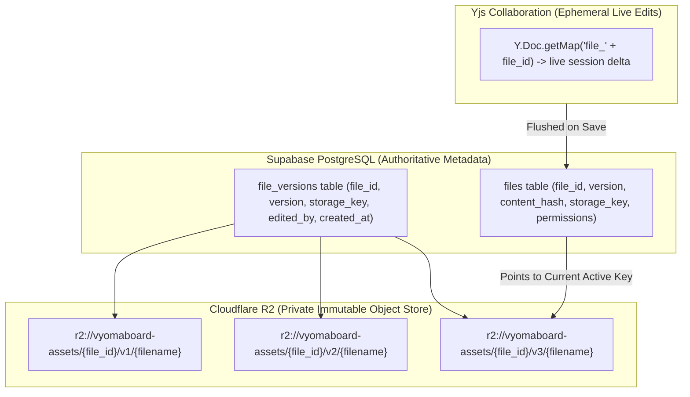

# VYOMABOARD — CANONICAL FILE IDENTITY & DOCUMENT ARCHITECTURE

## 1. Problem Statement: Legacy Identity Deficiencies
In the legacy implementation:
* Files were identified ambiguously by filename (`fileData.name`), URL string, or temporary whiteboard shape ID (`originShapeId`).
* Editing a file on the board saved localized diffs (`props.spreadsheetDiffs` or `props.content`) strictly onto the local Excalidraw shape.
* The original file creator retained a local reference while other attendees had another, resulting in split-brain file versions.
* Clicking "Download" downloaded the stale original upload URL (`fileData.url`), completely ignoring edits made by participants!

---

## 2. Canonical File Record Model

Every shared file in VyomaBoard has a single authoritative identity record stored in the primary database (Supabase PostgreSQL):

```typescript
export interface CanonicalFile {
  file_id: string;               // UUID v4 - Immutable primary identity
  school_id: string;             // Multi-tenant school ownership
  room_id: string;               // Associated whiteboard/classroom room
  original_owner_id: string;     // Creator profile UUID
  last_edited_by: string;        // Last editor profile UUID
  
  filename: string;              // Current user-visible filename
  extension: string;             // Normalized extension (e.g., 'csv', 'xlsx')
  mime_type: string;             // Verified MIME type (e.g., 'text/csv')
  category: FileCategory;        // 'spreadsheet' | 'code' | 'word' | 'presentation' | 'pdf' | 'image' | 'archive'
  
  storage_key: string;           // Cloudflare R2 object key
  current_version: number;       // Monotonically increasing version counter (1, 2, 3...)
  content_hash: string;          // SHA-256 cryptographic hash of current binary
  size_bytes: number;            // Current file size
  
  is_locked: boolean;            // Lock during active multi-user commit
  locked_by?: string;            // User holding commit lock
  
  created_at: string;            // ISO 8601 UTC timestamp
  updated_at: string;            // ISO 8601 UTC timestamp
}
```

---

## 3. Storage Separation & Single Source of Truth



### Core Architecture Rules:
1. **Immutable Storage Keys**: When a file is updated, a new immutable key is uploaded to Cloudflare R2 (e.g., `{file_id}/v{version}/{filename}`). The previous binary remains accessible in version history.
2. **Atomic Version Increment**: The file version is incremented atomically in PostgreSQL (`version = version + 1`).
3. **Whiteboard Node References `file_id`**: Whiteboard file cards store `file_id`. When any participant clicks or opens the file, the frontend fetches the current canonical record from PostgreSQL.
4. **Download Integrity**: The download action ALWAYS resolves the latest committed version from the canonical record, minting a short-lived presigned URL directly to the latest binary.
