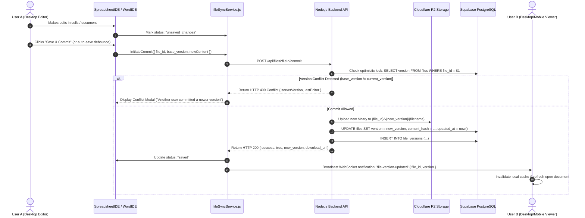

# VYOMABOARD — FILE SYNCHRONIZATION, VERSIONING & DOWNLOAD INTEGRITY

## 1. The Collaborative Save Lifecycle

---

## 2. Concurrency Control & Conflict Resolution
Binary document formats (DOCX, XLSX, PPTX) cannot be blindly merged like plain text. VyomaBoard implements:
1. **Optimistic Version Checking**:
   * Every edit session records the `base_version` loaded into memory.
   * On commit, the backend checks if `base_version === current_version`.
   * If another user committed in the interim, the commit is rejected with HTTP 409 Conflict rather than silently destroying the other user's changes.
2. **Explicit Conflict Resolution**:
   * User can choose:
     * *Overwrite with my version* (creates new version, increments version number).
     * *Save as new file copy* (creates `{filename} (Copy).xlsx`).
     * *Discard my changes & reload latest*.

---

## 3. Guaranteed Download of Latest Edited Version
* In the legacy code, `handleDownload` executed `link.href = fileData.url`, downloading the stale upload URL from when the file was first added.
* In the overhauled architecture, `handleDownload`:
  1. Calls `fileSyncService.getDownloadUrl(fileId)` to retrieve a fresh presigned URL for the **current committed canonical version**.
  2. If the user has unsaved edits in their active session, the editor prompts: *"You have unsaved changes. Would you like to commit before downloading?"*
  3. The resulting downloaded binary matches the active screen content with 100% cryptographic SHA-256 hash fidelity.
