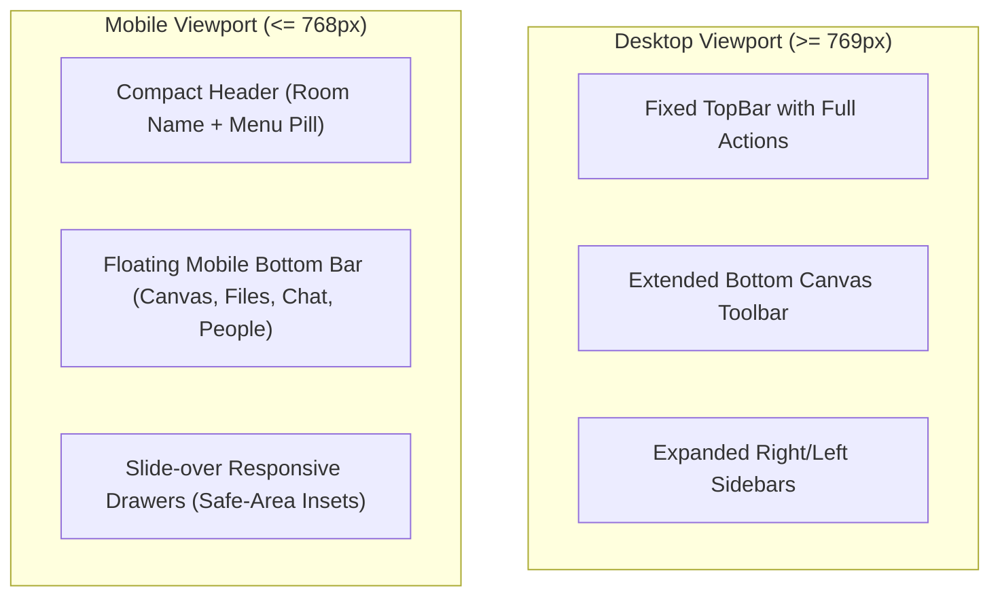

# VYOMABOARD — MOBILE EXPERIENCE & RESPONSIVE APPLICATION ARCHITECTURE

## 1. Core Mobile Design Policy
VyomaBoard enforces a strict operational policy regarding mobile devices:
> **PHONES ARE VIEW-ONLY DEVICES FOR SHARED FILES.**
> On phones, users can navigate the whiteboard, view shared documents, join voice/video sessions, read chat, and download canonical file versions. However, they **must not accidentally modify the underlying shared documents**. Desktop remains the primary authoring and editing environment.

---

## 2. Enforcement of Mobile Read-Only Policy
The read-only restriction is **enforced in application logic**, not merely by hiding CSS buttons:
1. `src/lib/deviceDetection.js`: Uses a unified detection utility combining `window.matchMedia('(max-width: 768px)')` and touch capability checks.
2. When `isMobileDevice()` is `true`:
   * `isEditing` state in `FileViewerModal` is locked to `false`.
   * Spreadsheet cell double-clicks, keyboard input, and row/column additions are disabled.
   * Word processor and Monaco code editors are placed in `readOnly: true` mode.
   * Destructive actions (delete file, clear annotations) are disabled.
   * A clean, non-intrusive status pill is displayed at the top:
     `👁️ Read-Only Mode (Desktop required for editing)`

---

## 3. Responsive UI & Navigation Re-Architecture

### 3.1 Mobile Viewport Adaptations
* **Safe-Area Inset Support**: CSS padding respects mobile notches and home indicator bars (`env(safe-area-inset-top)`, `env(safe-area-inset-bottom)`).
* **Touch-Optimized Hit Targets**: All clickable buttons in mobile viewports maintain a minimum touch target size of $44 \times 44\text{ px}$.
* **Compact Bottom Bar**: Consolidates Excalidraw actions, chat toggles, and participant lists into an ergonomic mobile bottom navigation bar.
