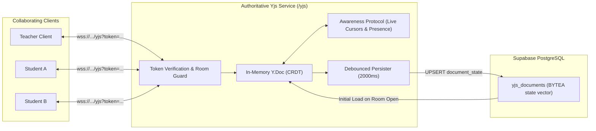

# VYOMABOARD — REAL-TIME COLLABORATIVE ARCHITECTURE (YJS & PRESENCE)

## 1. Problem Statement & Consolidation
The current VyomaBoard real-time synchronization is fractured across two competing and conflicting layers:
1. `src/useYjsStore.js` connects to a third-party public demo WebSocket (`wss://demos.yjs.dev/ws`) which drops connections and leaks classroom canvas data to the public internet.
2. It simultaneously saves raw byte snapshots into Firebase Firestore every 2.5 seconds.
3. Meanwhile, `backend/server.js` maintains an unused `/yjs` WebSocket server backed by local PostgreSQL.

---

## 2. Architecture Evaluation: Authoritative Real-Time Synchronization

### Option A: Cloudflare Durable Objects + Yjs
* **Pros**: Sub-millisecond global edge routing, automatic room hibernation when empty, zero backend server maintenance.
* **Cons**: Requires rewriting the Yjs WebSocket server protocol for Cloudflare Workers runtime; debugging state persistence at the edge has higher operational complexity for full-stack Node developers.

### Option B (Recommended): Dedicated Authenticated Node.js Yjs Service + Supabase PostgreSQL
* **Pros**:
  * 100% compatible with existing `y-websocket` client protocol and Excalidraw bindings.
  * Native PostgreSQL persistence using `yjs_documents` table in Supabase.
  * Direct integration with Supabase JWT authentication during WebSocket upgrade.
  * Full support for room presence, awareness, cursors, and custom cards without edge memory limits.
* **Cons**: Requires running the Node.js WebSocket process (which is already part of the VyomaBoard deployment).

**Architectural Decision**: Implement **Option B** as the primary authoritative synchronization architecture. Deprecate `demos.yjs.dev` and Firestore sync entirely.

---

## 3. Authoritative Yjs Server Implementation Details

---

## 4. Key Real-Time Capabilities

### 4.1 Token-Authenticated WebSocket Upgrades
Every connection to `/yjs?roomId=...&token=...` is validated against Supabase:
* Verifies the user has valid membership in the room or classroom.
* Rejects expired, forged, or unauthenticated tokens with `HTTP 401/403`.
* Prevents unauthorized eavesdropping on ongoing lectures or exams.

### 4.2 Awareness Protocol & Cyberpunk Live Cursors
* Live user cursors, user display names, and distinct avatar colors are synchronized via the Yjs Awareness Protocol.
* Stale cursors are automatically removed after 15 seconds of inactivity.

### 4.3 Debounced PostgreSQL Snapshotting
* Updates are merged in-memory using Yjs Conflict-Free Replicated Data Types (CRDTs).
* Changes are flushed to Supabase PostgreSQL (`yjs_documents`) via debounced background writes (2.0s interval), minimizing database write volume while guaranteeing zero state loss.

### 4.4 Inactive Room Cleanup & Garbage Collection
* When all participants disconnect from a room, the in-memory `Y.Doc` flushes its final binary state vector to PostgreSQL and is garbage-collected to reclaim server RAM.
