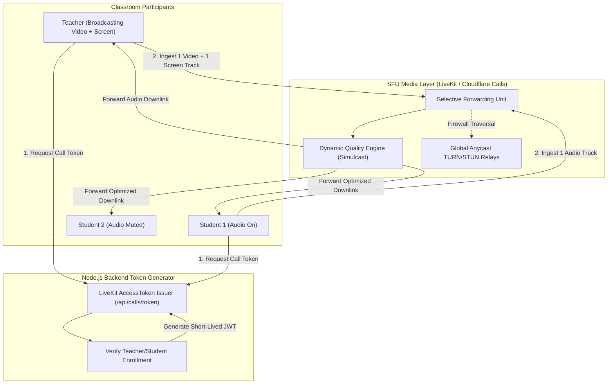

# VYOMABOARD — WEBRTC & REAL-TIME MEDIA ARCHITECTURE (AUDIO, VIDEO, SCREEN SHARING)

## 1. Problem Statement: Current Mesh Limitations
VyomaBoard currently relies on a client-side full-mesh WebRTC architecture (`src/context/CallContext.jsx`):
* Every participant establishes a bidirectional peer-to-peer connection with every other participant.
* For $N$ classroom attendees, there are $N(N-1)$ connections.
* At $N = 10$, each student machine must encode and upload 9 simultaneous video streams, crushing residential bandwidth, dropping frame rates, and overheating client hardware.
* Furthermore, it relies on public TURN credentials (`openrelayproject`) that can be terminated or rate-limited without notice.

---

## 2. Media Architecture Comparison: SFU vs Mesh

| Metric | Mesh (Current) | Cloudflare Calls SFU | LiveKit Cloud / Self-Hosted SFU |
| :--- | :--- | :--- | :--- |
| **Network Architecture** | Full P2P Mesh | Selective Forwarding Unit (Edge) | Selective Forwarding Unit (Global) |
| **Client Upload Streams** | $N - 1$ streams (Severe bottleneck) | **1 stream** (Optimized) | **1 stream** (Optimized) |
| **Participant Scale** | 3 - 5 max | 50 - 100+ | 100 - 1,000+ |
| **React Integration** | Complex raw WebRTC | REST / WebSocket signaling | Official `@livekit/components-react` |
| **Screen Share Quality** | Drops under load | 1080p 30/60fps stable | 1080p/4k 30/60fps with simulcast |
| **Simulcast & Dynacast**| No | Automatic | Automatic (adjusts per recipient) |
| **Recording Capabilities**| None | Cloudflare Stream export | Native Egress to Cloudflare R2 |
| **TURN Infrastructure**| Public OpenRelay | Included globally | Included in Cloud or Coturn |
| **Operational Overhead**| High bug rate | Minimal (Serverless) | Minimal (Cloud) / Moderate (Self-host) |

**Architectural Decision**: Adopt **LiveKit Cloud / Self-Hosted SFU** (or Cloudflare Calls where edge serverless is preferred). LiveKit provides production-ready React components, granular host controls, tokenized room permissions, and zero $O(N^2)$ mesh overhead.

---

## 3. Production Media Architecture Diagram

---

## 4. Key Classroom Controls & Security Requirements
1. **Teacher Privilege Enforcement**: Only verified teachers can mute students, stop unauthorized screen shares, or remove disruptive participants from the media bridge.
2. **Short-Lived Ephemeral Media Tokens**:
   * Meeting tokens are minted by the backend API using cryptographic secrets.
   * Tokens expire after 10 minutes if unused, and sessions terminate immediately upon class dismissal.
3. **No Hardcoded Credentials**: Public OpenRelay credentials are removed. All TURN fallback relies on authenticated server infrastructure.
4. **Adaptive Bitrate & Simulcast**: Automatically scales resolution down for students on cellular or low-speed connections without affecting the teacher or other students.
